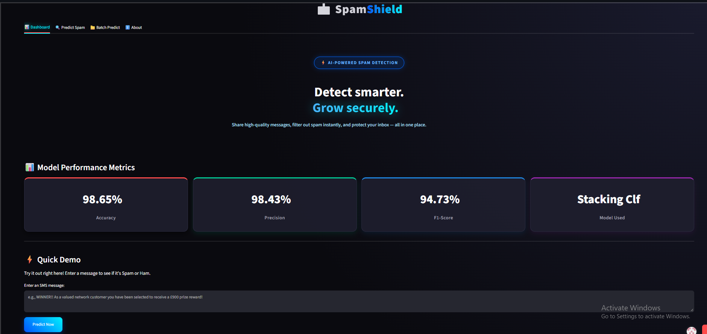
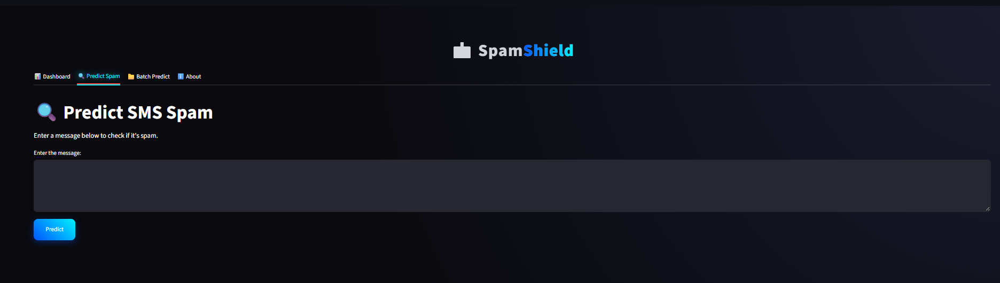
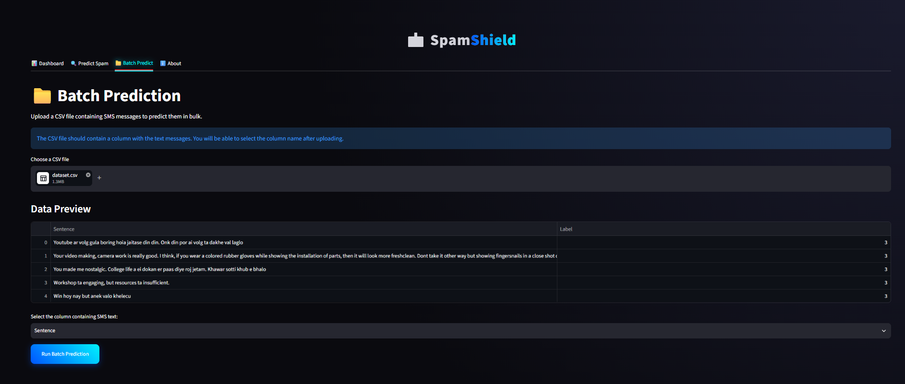

# 📩 SMS Spam Classifier


An end-to-end Machine Learning web application that detects whether an SMS message is **Spam** or **Ham (Not Spam)** using Natural Language Processing (NLP) and Machine Learning.# 📩 SpamShield: End-to-End SMS Spam Classifier

An enterprise-grade, production-ready Machine Learning web application designed to detect and filter SMS spam messages in real-time using Natural Language Processing (NLP) and an advanced Stacking Ensemble architecture.

---

## 🌐 Live Deployment

* **🚀 Streamlit App:** [Access Live Application](https://smsspamclassifier-2ozcpwt4scvdrtrnvdytug.streamlit.app/)
* **💻 GitHub Repository:** [Source Code](https://github.com/Kazi-Sadman/sms_spam_classifier)

---

## 📸 App Architecture & UI Previews

Place your `.png` screenshot assets inside the `docs/images/` directory matching the structure below:

### 📊 SaaS Dashboard & Performance Metrics (`dashboard.png`)
The main dashboard features a modern analytics overview highlighting real-time model evaluation metrics.


### 🔍 Single Message Inference (`predict.png`)
Interactive single-message classification interface providing immediate spam/ham detection with confidence scoring.


### 📁 Bulk Batch Processing (`batch.png`)
CSV batch-upload pipeline allowing users to process large volumes of SMS messages simultaneously.


---

## 🧠 Machine Learning & NLP Pipeline

```text
Raw SMS Text Data 
  │ 
  ▼ 
Data Cleaning (Null handling & removal of 403 duplicate rows → 5,169 clean samples)
  │ 
  ▼ 
Text Preprocessing (Lowercasing, Tokenization, Special Character Removal, Stopword Filtration, Porter Stemming)
  │ 
  ▼ 
Feature Extraction (TF-IDF Vectorization with max_features = 3,000)
  │ 
  ▼ 
Stacking Ensemble Classifier (Base Estimators: SVM, BernoulliNB, ExtraTreesClassifier ──> Meta-Learner: RandomForest)
  │ 
  ▼ 
Inference / Prediction (Spam [1] vs. Ham [0])
```

### Model Performance & Evaluation
Due to the class imbalance inherent in spam detection datasets, optimization prioritized high precision to minimize false positives (flagging legitimate messages as spam).

| Metric | Score |
| :--- | :--- |
| **Accuracy** | 98.65% |
| **Precision** | 98.43% |
| **F1-Score** | 94.73% |

---

## 🛠️ Tech Stack & Dependencies

* **Frontend / UI:** Streamlit (Custom Dark-Theme SaaS Styling)
* **Core Language:** Python 
* **Machine Learning:** Scikit-Learn (Ensemble Stacking Classifier)
* **Natural Language Processing:** NLTK (Natural Language Toolkit)
* **Data Manipulation:** Pandas, NumPy

---

## 📂 Project Structure

```text
sms_spam_classifier/
├── app.py                  # Main Streamlit application
├── model.pkl               # Serialized TF-IDF vectorizer & Stacking model pipeline
├── requirements.txt        # Python package dependencies
├── README.md               # Project documentation
├── docs/                   # Documentation and UI assets
│   └── images/             # UI Screenshots (.png)
│       ├── dashboard.png
│       ├── predict.png
│       └── batch.png
└── dataset/                # Raw and cleaned dataset files
```

---

## 🚀 Run Locally

### 1. Clone the Repository
```bash
git clone https://github.com/Kazi-Sadman/sms_spam_classifier.git
cd sms_spam_classifier
```

### 2. Set Up a Virtual Environment
```bash
python -m venv .venv
# On Windows:
.venv\Scripts\activate
# On macOS / Linux:
source .venv/bin/activate
```

### 3. Install Dependencies
```bash
pip install -r requirements.txt
```

### 4. Run the Streamlit Application
```bash
streamlit run app.py
```
* The application will launch locally at `http://localhost:8501`.

---

## 📜 License & Acknowledgments

* Built as an educational portfolio project demonstrating robust NLP pipeline design and MLOps deployment.
* Dataset sourced from the UCI Machine Learning Repository (SMS Spam Collection Dataset).

---

## 👨‍💻 Author

**Kazi Sadman Zahin**  
* GitHub: [@Kazi-Sadman](https://github.com/Kazi-Sadman)

## 🚀 Live Demo

🔗 **Streamlit App:**
`https://smsspamclassifier-2ozcpwt4scvdrtrnvdytug.streamlit.app/`

## 📖 Overview

This project uses the popular SMS Spam Collection Dataset. The model is trained to classify text messages into two categories: Spam (1) and Ham (0). The application features a modern, interactive user interface built with Streamlit.

## ✨ Features

- **📊 Dashboard:** Modern SaaS-style hero section with model performance metrics.
- **🔍 Predict Spam:** Single message prediction with a confidence score.
- **📁 Batch Predict:** Upload a CSV file containing multiple SMS messages to get bulk predictions.
- **ℹ️ About:** Detailed information about the dataset, NLP pipeline, and model selection.

## 🛠️ Tech Stack

- **Frontend:** Streamlit (with custom CSS for a modern, dark UI)
- **Backend:** Python
- **Machine Learning:** Scikit-Learn (Stacking Classifier)
- **NLP:** NLTK (Natural Language Toolkit)

## 🧠 NLP & Model Pipeline

1. **Data Cleaning:** Removed unnecessary columns, handled missing values, and removed 403 duplicate rows (5,169 final rows).
2. **Text Preprocessing:** Lowercase conversion, Tokenization, Removing special characters, Removing stopwords, and Stemming (PorterStemmer).
3. **Feature Engineering:** Converted text to numerical features using **TF-IDF** with `max_features=3000`.
4. **Model Training:** Trained and evaluated multiple models.
5. **Final Model Selection:** **Stacking Classifier** combining SVM, BernoulliNB, and ExtraTreesClassifier with a RandomForest meta-learner.
   - **Accuracy:** 98.65%
   - **Precision:** 98.43%
   - **F1-Score:** 94.73%

## 🚀 How to Run Locally

1. Clone the repository:
   ```bash
   git clone https://github.com/Kazi-Sadman/sms_spam_classifier.git
   cd sms_spam_classifier
   ```
